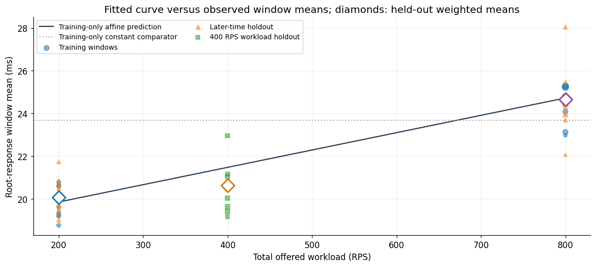

# Mean-response constraints on GAMMA

## Visual baseline review

Open [the executed baseline notebook](../gamma_baseline.ipynb). Seven figures show
the RPC graph, phase-aligned measurements, request coverage, response distributions,
fitted predictions and held-out errors. Compact derived inputs are included in
`notebook_data/`; the notebook runs without the raw download.

The training-only affine aggregate fit predicts **21.473 ms** at the held-out
400 RPS workload versus an observed weighted mean of **20.620 ms**. Its weighted
window-mean MAE is **1.100 ms** there and **0.748 ms** on later-time endpoint
workload holdouts. These are exploratory prediction errors, not a certificate
or a fitted graph-aware queueing model. No long inference was run.




The experiment studies posterior restriction subject to preservation of the mean
response curve across offered workloads. Its target is the detailed-model
posterior conditioned on a certified behavioral set, not the original posterior.

## Reproduce the observed-data pilot

From the repository root:

```sh
python -m examples.queueing.gamma_study download \
  --data-dir /path/to/gamma-small --max-total-bytes 100000000
python -m examples.queueing.gamma_study prepare \
  --data-dir /path/to/gamma-small --output-dir /tmp/gamma-pilot \
  --window-seconds 10 --guard-seconds 5 --baseline-seconds 60 120 240
```

`sample_manifest.json` pins version 1, source URLs, decoded byte lengths and
SHA-256 hashes for 24 files (57,545,387 uncompressed bytes). The downloader fetches
individual files, not the 67.66 GB archive, validates single-file ZIP responses,
and refuses files outside its budget or with different contents. Data remain
outside the repository. `pilot/` contains the measured output, not synthetic
fixtures. Unit tests use small synthetic inputs.

Sources: [GAMMA dataset](https://doi.org/10.34740/kaggle/dsv/7638732),
[GAMMA paper](https://www3.cs.stonybrook.edu/~anshul/www24_gamma.pdf), and
[official preprocessing](https://github.com/PACELab/GAMMA/tree/406109b0d9946f54163c149b672780df6957d5c0).
The dataset is Apache-2.0 licensed. Exact exporter links are in the manifest.

## Measurement and scope

Rows in the paired start-time and duration matrices represent requests; columns
represent RPC nodes. The `ids` file identifies nodes, not request IDs. Both time
fields are microseconds, established from the Jaeger exporter and preprocessing,
not inferred from their magnitudes. Phase-log timestamps are seconds. Root node
0 supplies the response duration. These are inclusive span durations, **not
intrinsic service requirements**; nested/overlapping RPCs and cross-host clock
skew prevent treating the matrix as additive service demands.

This pilot selects the compose request's graph 1 at 200, 400 and 800 total offered
requests/second. It does not estimate the unconditional application-wide curve.
The 30-node graph matches across these runs. Exported requests are not initially
chronological; the loader preserves original row indices and sorts by root start.
It records child-before-root clock-skew counts rather than silently repairing them.

All injected-host phase logs are required. A request whose interval intersects a
phase boundary plus/minus five seconds is guarded. Ten-second windows mixing
phases, guarded windows, and first/last observed windows are excluded from the
curve table. These analysis choices are configurable; they do not reproduce the
paper's one-second classification windows. `no_logged_interference` means outside
the logged injection intervals, not a proof of stationarity or absence of other
interference. Warm-up alignment also differs: observed traces begin about 269
seconds before the first injection at 200 RPS and about 539 seconds before it
at 400/800 RPS, while arguments specify a 300-second warm-up. No common
steady-state observation interval is assumed by these descriptive summaries.
Interference schedules differ across runs and are not pooled into
a load-only curve.

| Offered RPS | Retained requests, no logged injection | Request-weighted mean (ms) |
|---:|---:|---:|
| 200 | 8,278 | 20.363943 |
| 400 | 14,238 | 20.883754 |
| 800 | 27,930 | 25.527923 |

The pilot reads 86,544 total request rows before exclusions. These three
single-run descriptive means are neither calibrated uncertainty bounds nor an
inference acceleration result. `windows.csv` retains sample counts, dispersion,
phase and observed graph-specific rates; the latter differ from total offered RPS.
`curves.csv` weights windows by request counts. `audit.json` records extraction,
quality checks and treatment intervals.

## Equal-duration sensitivity check

`phase_aligned_baselines.csv` uses windows ending five seconds before the first
injection in each run, excluding requests crossing either window edge. All
windows are within the observed timestamp range. Means in milliseconds are:

| Window duration | 200 RPS | 400 RPS | 800 RPS |
|---:|---:|---:|---:|
| 60 seconds | 20.038 | 21.166 | 24.160 |
| 120 seconds | 20.064 | 20.987 | 24.652 |
| 240 seconds | 19.950 | 20.617 | 24.711 |

The descriptive ordering persists under equal-duration, phase-aligned windows;
it is not solely an artifact of pooling differently sized interference-free
periods. This check does not establish that warm-up has ended or that the runs
are stationary. The exporter does not supply a verified common warm-up origin.

## Paired inference protocol

`hierarch_inf.queueing.experiments` provides `MeanResponseConstraint`, explicit
absolute/relative tolerance construction, and `run_paired_inference`. Supply:

1. A detailed model, its likelihood/prior and a parameterization valid across the
   selected workloads. Queue discipline, service law and stability domain must
   be specified; RPC span duration is not a valid substitute for service demand.
2. A reference curve and workload-dependent tolerance in seconds. Estimate the
   reference on training runs/blocks, keeping validation blocks separate.
3. A fixed lower/upper enclosure of the detailed mean response for each parameter
   at each workload. For a reduced model, this combines reduced-mean uncertainty
   with the detailed/reduced contract radius. Simultaneous coverage is needed for
   learned bounds used after parameter selection. A point prediction is not a
   certificate. Bounds must have justified tail control/finite means.
4. A certified initial ensemble with positive posterior mass in the retained set.

The restricted run rejects a parameter before likelihood evaluation unless its
entire enclosure lies in the allowed mean-response band. Full and restricted
runs use the same initial ensemble, seed and sampler configuration. They target
different distributions. The interface records likelihood evaluations,
certificate calls/time, sampler wall time and caller-supplied construction cost.
It includes initial certification and diagnostics in restricted total cost;
report all reference training, bound fitting and initial-ensemble search in
`setup_seconds`. ESS is for each run's own target, not evidence of equivalence. The inherited
autocorrelation estimate uses `tol=0`; the helper labels ESS exploratory and
convergence unverified even when it returns a numerical score.

Use independent seeds and repeat both orders when benchmarking wall time;
the helper runs full then restricted and is not itself a randomized timing study.
Compare behavior violations on held-out blocks/workloads, retained posterior
mass, likelihood calls, total cost and target-specific mixing diagnostics. A
fixed number of sampler steps is not evidence of convergence or speedup.

For measured-data evaluation, split entire chronological blocks or independent
runs before fitting; do not randomly split adjacent requests. Keep injection
regimes separate and use boundary guards in every split. Expand to replicate runs
before inferential uncertainty claims. A held-out workload tests interpolation
or extrapolation empirically; a grid certificate covers only its stated grid.
The current pilot selects no queue discipline, service law, likelihood,
reference estimator or tolerance magnitude. The executable comparison accepts
those choices rather than silently defining a scientific model.

### Notebook execution environment

The committed notebook was executed cell-by-cell with IPython in a fresh process;
all seven figures are actual captured outputs. Local Jupyter kernel sockets were
blocked by the execution sandbox, so `examples/queueing/execute_gamma_notebook.py`
provides the in-process execution path (Matplotlib Agg plus rich PNG display).
A normal Jupyter environment can use `nbconvert --execute` instead. Neither path
runs posterior sampling. Install `requirements-notebook.txt` first.
